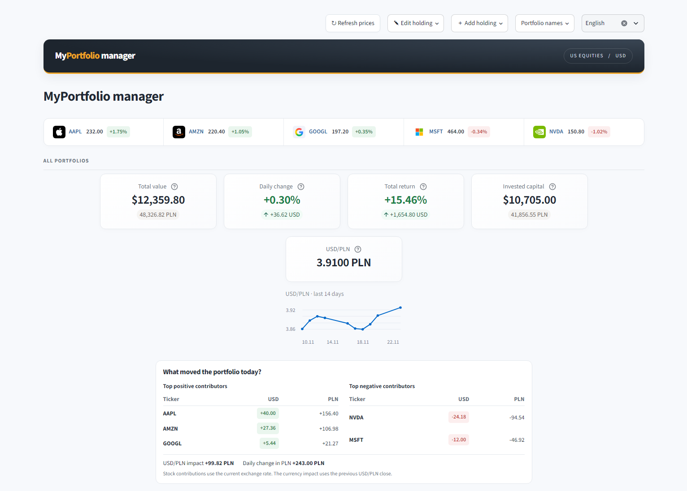
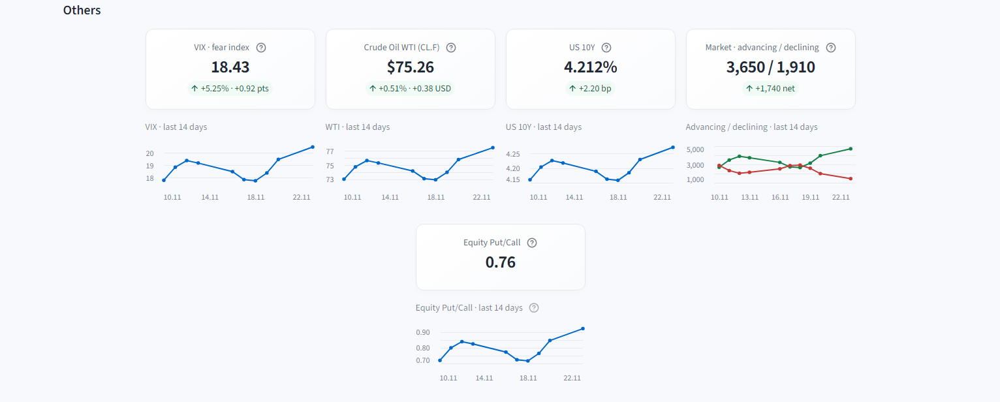

<div align="center">

# 📈 MyPortfolio manager

**Your holdings, market context and upcoming events in one dashboard.**


[Quick start](#quick-start) · [Try the demo](#demo) · [Market overview](#market-overview) · [Deployment](#deployment)

</div>

---

Version **v0.10**. A Streamlit dashboard for the **Erste-DM** and **XTB** portfolios,
with Polish and English interface options and English-only company news.
Portfolio display names can be changed in the **Portfolio names** menu in the
top toolbar. Names must be unique and contain 1-40 characters. Display names
are stored separately; stable internal IDs preserve holdings and column layouts.
Holdings are entered manually; the application does not connect to brokerage accounts.

| 💼 Track your portfolios | 🌎 Follow the market | 📅 Stay informed |
|---|---|---|
| Holdings, weighted average prices and returns | VIX, US 10Y, breadth and Put/Call | Earnings and dividend dates |
| Daily gains and losses by holding in USD and PLN | Sector map, Cash instruments and futures | US economic calendar |
| Saved columns and mobile holding cards | Pre-market and after-hours quotes | One shared English news feed |

<details>
<summary><strong>📚 Contents</strong></summary>

- [Screenshots](#screenshots)
- [Start on Windows](#quick-start)
- [Demo mode](#demo)
- [Sign-in and language](#sign-in)
- [Holdings and performance](#holdings)
- [Tables and mobile layout](#mobile)
- [Earnings and dividends](#earnings)
- [After-hours & stuff](#market-overview)
- [News and refresh controls](#refresh)
- [Files and private data](#files)
- [Dependencies and validation](#dependencies)
- [macOS, Linux and AWS EC2](#deployment)
- [Troubleshooting](#troubleshooting)
- [Releases](#releases)

</details>

## Screenshots

Both screenshots use fictional holdings and sample market data.

### Portfolio overview



### Market indicators



<a id="quick-start"></a>

## 🚀 Start on Windows

> [!TIP]
> Already installed? Double-click **`start.bat`**. To explore with fictional holdings, use **`start_demo.bat`** instead.

Double-click **start.bat**, or run this command from the project directory:

```powershell
.\.env\Scripts\python.exe -m streamlit run app.py
```

`app.py` is the only entry point. The browser opens automatically at
**http://localhost:8501**. Keep the terminal open and press **Ctrl+C** to stop
the server. Closing the browser tab does not stop it.

For first-time installation, use Python **3.12+**:

```powershell
python -m venv .env
.\.env\Scripts\python.exe -m pip install --no-cache-dir -r requirements.txt
.\.env\Scripts\python.exe -m portfolio_app.credentials
.\.env\Scripts\python.exe -m streamlit run app.py
```

Skip environment creation if `.env` already works. Explicit Python paths do not
require activation; `start.bat` activates the environment for you.
`--no-cache-dir` avoids shared pip cache permission problems.

On a fresh clone, `start.bat` prompts you in the terminal to set a password for
**admin**. The credentials command above does the same for manual launches.
Both portfolios start empty and the first holding you add creates
`data/portfolio.json`.

To move an existing installation, copy its private `data/` directory from your
backup into the clone before starting. This restores your sign-in, holdings and
saved settings. To keep just your sign-in, copy `data/auth.json`.

Use `--server.headless=false` to open the browser or `--server.headless=true`
to run without opening it. Restart the server after backend, configuration or
dependency changes; F5 alone does not replace a server restart.

<a id="demo"></a>

## 🎬 Demo mode

1. Stop the normal application with Ctrl+C.
2. Run **start_demo.bat** and sign in as **admin**, with no password.
3. Stop the demo and run **start.bat** to return to your own holdings.

The demo has six fictional holdings across both portfolios, including fractional
shares and a shared ticker. Quotes, news and calendars still use real providers.
Each launch copies `examples/demo_portfolio.json` to
`.streamlit/demo/portfolio.json`, replacing previous demo holdings. Demo layout,
sessions and logs also use `.streamlit/demo/`. Regular holdings in `data/` are
not modified. The launcher sets `PORTFOLIO_DEMO=1`: the sign-in form shows only
the **admin** username, and demo authentication does not require `data/auth.json`.
Sign in before presenting and exclude private data when distributing a copy.

<a id="sign-in"></a>

## 🔐 Sign-in and language

- Username: **admin**. Demo mode requires no password. In normal mode,
  passwords are not stored as plain text in code or this
  README. `data/auth.json` contains a random salt and a scrypt password hash.
- Sessions last up to **eight hours within one server process**. F5 and module
  reloads preserve sign-in. Restarting or forcibly terminating the server
  invalidates its old sessions.
- Session cookies use `HttpOnly`, `SameSite=Lax`, and `Secure` under HTTPS.
  Only token hashes are stored in the session database.
- **Log out** revokes the session. Password changes invalidate sessions.
  Five failed attempts trigger a one-minute cooldown for the client address.
- Select Polish or English at sign-in or in the top toolbar. The `lang=pl` or
  `lang=en` URL parameter takes precedence over the language cookie, saved for
  a year during sign-in and sign-out.

<a id="holdings"></a>

## 💼 Holdings and performance

Choose Erste-DM or XTB. Tab switching happens in the browser to preserve scroll
position. Summaries cover market value, invested capital, daily change and
return since purchase, separately per portfolio and for all holdings together.

- When adding or editing a position, Erste-DM accepts whole shares and XTB
  supports fractional shares with four decimal places. The holdings table
  and mobile view display quantities using the portfolio's precision.
- Daily position change in USD is `shares * (price - previous session close)`.
  Portfolio daily percentages are weighted by previous-close position values.
  Missing reference prices or mixed quote dates prevent incomplete totals.
- Return since purchase compares market value with invested capital and excludes
  dividends, commissions and currency movements.
- The **USD/PLN** tile in **All portfolios** shows the current rate, its daily
  change and a 14-calendar-day chart of daily Yahoo Finance rates (`PLN=X`).
  Total value, portfolio market values and invested capital use the current
  rate rounded to four decimals for their PLN equivalents.
- **What moved the portfolio today?** shows up to three positive and three
  negative contributors in USD and PLN, for each portfolio and across all
  holdings. The combined view adds together positions with the same ticker.
- The daily breakdown converts stock contributions using the USD/PLN rate for
  the quoted stock session. It reports the currency impact on the prior USD
  value separately. When the live FX quote is from a different date, the app
  uses the historical USD/PLN close for the stock session. The combined change
  in PLN appears when both FX rates are available. Return since purchase uses
  the USD acquisition cost. The app does not store your original FX rate.
- Positive changes are green; negative changes are red, including VIX.
  Color indicates direction, not whether a move is favorable.

**Add position** accepts a portfolio, Yahoo symbol, purchased shares and purchase
price in USD. New USD-listed stocks and ETFs are verified and names resolved
automatically. Repeated purchases in one portfolio update shares and the weighted
average price. The same ticker in the other portfolio remains independent.

The quote strip below the MyPortfolio manager header loads logos automatically
for every current and newly added symbol using the [Parqet Logo API](https://developers.parqet.com/docs/assets/logos).
Logos appear only in this top strip. Images are loaded and cached by the browser;
an unavailable logo leaves the ticker and quote readable.

**Edit position** replaces total shares and average purchase price. Both must be
positive finite numbers. Deletion removes the selected aggregate holding only.
Empty portfolios are supported. Writes are atomic and stale edits are rejected.
Changing shares alone does not force quotes or company news to reload.

Expand the allocation section for the donut chart. New symbols receive stable
colors. Share counts display two decimals; editing retains four-decimal input
precision.

<a id="mobile"></a>

## 📱 Tables and mobile layout

The visible-column menu hides, restores and adds available columns. Drag a
header or its grip to reorder columns. Keyboard users can focus the grip and
use Alt+Left/Right. Clicking a header label sorts rows. On touchscreens, drag
the grip; swiping the label remains available for native scrolling.

Visibility and order are saved in `data/layout.json` per portfolio and persist
across refreshes and restarts. Devices using this installation share the layout.
At widths up to **1100 px**, holding cards replace desktop tables and respect
the same visible fields and ordering. Summary cards wrap to fit narrow screens.

The interface is designed for desktop browsers, macOS, iPhone and iPad.
Automated checks do not replace visual testing on every physical device.
Mobile browsers may suspend background tabs; refresh manually when necessary.

<a id="earnings"></a>

## 📅 Earnings and dividends

The calendar is **collapsed by default**. It shows each ticker once across all
portfolios, lists the associated portfolios and uses combined current shares
for estimated gross dividend totals. Cards are sorted by the next known event.

Earnings dates come from Yahoo and may be estimated dates or ranges. Declared
dividends, ex-dividend dates and payment dates come from Nasdaq through
`curl-cffi`, with a date-only Yahoo fallback where available. Annual rates and
historical payments are never substituted for a future dividend amount.

Dividend fields appear only when an upcoming payout or positive Yahoo-reported
dividend rate confirms dividend activity. Other or unconfirmed statuses hide
these fields. Confirmed payers without a declared next payout retain fields
with dashes. Provider-based classification cannot guarantee future policy.

Amounts are gross, in the reported currency. Current ownership does not prove
entitlement. A past ex-dividend date can accompany a future payment date.

Data is fetched once per ticker per browser session when the section opens.
Minute refreshes, language changes and quote refreshes do not reload it.
New tickers are fetched once. F5 starts a fresh calendar snapshot. Totals still
recalculate from current holdings without additional calendar requests.

<a id="market-overview"></a>

## 🌎 After-hours & stuff

### Tickers

One card per symbol covers all portfolios. Valid current-day pre-market data
appears before the regular session; after-hours data appears after it. During
regular trading, extended prices and percentages are dashes, including table
columns. Missing data never removes a ticker's card.

Direct Yahoo extended quotes and valid one-minute bars are compared by timestamp;
the newest is used, with the direct quote preferred on a tie. Minute bars are labeled.
Percentages are calculated from the selected price and the relevant regular close,
rather than copied from Yahoo's percentage field.
Exchange schedules account for DST and early closes. Stale-session
and future timestamps are rejected at fetch and display time. Pre-market changes
use the previous regular close; after-hours changes use that day's regular
close. Portfolio valuation always uses regular-session prices.
Before the open, an empty one-day regular-session response falls back to the
last session within five trading days. Extended quotes refresh the exchange
schedule when the regular-session response still describes an older day.

### Indexes

Investing.com supplies these specific instruments:

- US Tech 100 Cash (`1175151`) and related CME Nasdaq 100 futures (`8874`).
- US 500 Cash (`1175153`) and related CME S&P 500 futures (`8839`).

These are Investing.com Cash instruments, not Yahoo official index quotes.
Identities are validated; unavailable instruments are not silently replaced.
Futures show dashes during the regular stock-market session, based on the
available portfolio exchange schedule. Two pages supply both pairs, cached
for 55 seconds.

### Others

| Indicator | Meaning and source | Cache |
|---|---|---|
| VIX | Volatility level and daily change, Yahoo `^VIX` | 55 seconds |
| Crude Oil WTI (CL.F) | WTI futures in USD per barrel and daily change, direct Yahoo chart endpoint `CL=F` (no yfinance cache DB) | 55 seconds |
| US 10Y | Treasury yield in percent; change in basis points, Yahoo `^TNX` | 10 minutes |
| Advancing / declining | Finviz counts for NYSE, Nasdaq and AMEX; delta is net advances, not day-over-day change | 10 minutes |
| Equity Put/Call | Cboe daily equity option volume ratio, excluding index and ETF options | 10 minutes |
| Sector map | Daily changes of 11 Select Sector SPDR ETFs from Yahoo | 5 minutes |
| US economic calendar | Upcoming 45 days from BLS, BEA and Federal Reserve schedules | 6 hours |
| Fear & Greed | US equity sentiment from FearGreedFlow | 10 minutes |

Dates and retrieval times are available in tooltips where appropriate. Finviz
does not provide an observation timestamp. Indicators do not affect portfolio
valuation. Missing values are dashes.

The compact breadth chart uses a green line for advancing issues and a red line
for declining issues over the last 14 calendar days. Hover over a point to see
both counts and net advances. When the dashboard refreshes, it saves the latest Finviz
reading fetched at least 15 minutes after that day's regular US session closes
in `market_breadth.sqlite3` beside the portfolio file. History starts with the
first saved reading. Equity Put/Call has its own chart showing available daily
Cboe equity put/call ratios from the last 14 calendar days.

The 14-day line charts use daily Yahoo Finance data for VIX (`^VIX`), US 10Y
(`^TNX`), WTI futures (`CL=F`), and the Nasdaq 100 and S&P 500 cash indexes
(`^NDX` and `^GSPC`). The Investing.com tiles continue to show their live
Cash and Futures quotes. The chart tooltips show the trading date for each
point. The calendar-day axis leaves space for weekends and other days without
observations.

The sector map uses equal-sized tiles, not capitalization weights. It covers
technology, financials, energy, health care, industrials, materials, consumer
discretionary, consumer staples, utilities, real estate and communication
services through XLK, XLF, XLE, XLV, XLI, XLB, XLY, XLP, XLU, XLRE and XLC.

The economic calendar covers CPI, PPI and employment releases (BLS), GDP and
personal income/outlays (BEA), and Fed decision dates. Confirmed times convert
to **Europe/Warsaw (CET/CEST)**; unconfirmed times stay unspecified. If BLS is
unavailable, Forex Factory offers a limited current-week fallback. Missing
primary sources are reported. Release dates may change.

FearGreedFlow is an external stock-market sentiment source, not an official CNN
endpoint or a cryptocurrency index. Scores must be 0-100, no more than seven
days old, and not future-dated. Gauge bands are extreme fear below 25, fear below
45, neutral through 55, greed below 75, and extreme greed from 75.

<a id="refresh"></a>

## 📰 News and refresh controls

The common company-news feed covers both portfolios and shows up to **10
deduplicated English articles from the last seven days**, with source, time and
links. Cards show a publisher thumbnail when available and a ticker logo as the
fallback. Each slot goes to the ticker with the fewest stories selected so far
and an article available. The newest story wins ties. The feed displays the
selected articles in reverse chronological order. Some publishers require
subscriptions.

Quotes refresh every **60 seconds** while the sidebar option is enabled.
Manual quote refresh clears quotes, FX, benchmarks, VIX, context, sector and
macro caches. News has a separate refresh button and a ten-minute cache.
Holdings calendars retain their browser-session snapshot.

Independent benchmark, VIX, oil, market-context and sentiment reads run in
parallel with up to four workers. The live USD/PLN quote and its daily history
also load in parallel. The chart and portfolio summaries share that history
within a refresh. Each data source retains its cache lifetime, and rendering
stays on Streamlit's script thread.

The sidebar **Info** checkbox is off by default. It controls final source,
retrieval-time, delay and stale-quote notes for the current browser session.
Relevant provider errors are still reported.

Quotes can be delayed. Outside trading hours, the last regular-session price
remains visible. Failed updates can retain the last complete matching ticker
snapshot with a warning; partial portfolio totals are not invented.

<a id="files"></a>

## 🗂️ Files and private data

| Path | Purpose |
|---|---|
| `app.py` | Entry point and HTTP server setup |
| `portfolio_app/` | Application modules |
| `start.bat`, `start_demo.bat` | Windows launchers |
| `examples/demo_portfolio.json` | Public fictional demo seed |
| `data/portfolio.json` | Private holdings and average prices |
| `data/layout.json` | Saved column visibility and order |
| `data/portfolio_names.json` | Custom display names for the two portfolios |
| `data/auth.json` | Username, password salt and hash |
| `.streamlit/config.toml` | Theme and Streamlit configuration |
| `.streamlit/sessions.sqlite3` | Hashed authentication tokens |
| `.streamlit/demo/` | Generated demo data, layout, sessions and logs |
| `logs/` | Rotating access and error logs |
| `.env/` | Local Python environment |
| `.gitignore` | Private data and generated-file exclusions when using Git |

`PORTFOLIO_PATH`, `LAYOUT_PATH`, `SESSION_DB_PATH` and `LOG_DIR` override runtime
storage locations. The default layout file is beside the holdings file.
Authentication configuration remains in `data/auth.json`.

The included `.gitignore` excludes private data, sessions, logs, generated demo
data, caches and the Python environment when the project is placed under Git.
A release tag is a code snapshot, not a backup of holdings or credentials.

> [!IMPORTANT]
> Back up **`data/`** separately before updating or moving the application. Do not include private holdings or authentication files in a public repository.

Preserve
`.streamlit/config.toml`. Recreate `.env` on a new machine rather than copying
a Windows environment to another OS. Python caches can be deleted and rebuild
automatically.

Access logs contain request paths, client addresses, statuses, durations and
sign-in events. Error logs contain application and provider problems. Both use
UTC, rotate at **5 MB** and retain up to **five backups**. Passwords, form bodies
and query strings are not logged. WebSocket duration covers the whole connection.

<a id="dependencies"></a>

## 🧩 Dependencies and validation

`requirements.txt` lists Streamlit, pandas, yfinance, curl-cffi and langdetect.
Pip also installs Starlette through Streamlit. The app uses it for its HTTP
routes and request logging.

```powershell
.\.env\Scripts\python.exe -m pip check
.\.env\Scripts\python.exe -m unittest discover -s tests
```

Automated checks cover PL/EN rendering, cache behavior, chart refresh and date
tooltips, daily contributor rankings, the historical USD/PLN fallback, news
thumbnail selection, market-data parsers and authentication. Live data
availability depends on the providers.

<a id="deployment"></a>

## ☁️ macOS, Linux and AWS EC2

Copy the source, requirements, configuration and your separately backed-up data.
On Ubuntu, install Python and venv support first:

```sh
sudo apt-get update
sudo apt-get install -y python3 python3-venv python3-pip
```

On macOS or Linux with Python 3.12+ available:

```sh
cd /path/to/project
python3 -m venv .env
.env/bin/python -m pip install --no-cache-dir -r requirements.txt
.env/bin/python -m portfolio_app.credentials
.env/bin/python -m streamlit run app.py --server.headless=true
```

For EC2, append `--server.address=0.0.0.0 --server.port=8501`. Restrict the
security-group rule to your client IP. Use HTTPS through a reverse proxy or an
SSH tunnel for remote access. A systemd service can keep the app running after
SSH disconnects; configure its working directory and runtime write permissions.

<a id="troubleshooting"></a>

## 🛠️ Troubleshooting

- **pip permission errors:** use `--no-cache-dir` and the environment's Python.
- **Missing modules:** install and run with the same `.env` interpreter.
- **Missing `data/auth.json` after cloning.** Git excludes the private `data/`
  directory. To keep your existing password, restore `data/auth.json` from your
  backup. To choose a new password, run `python -m portfolio_app.credentials`
  in the project directory with the virtual environment active. Refresh the
  sign-in page and enter the password for **admin**.
- **Method Not Allowed after sign-in:** start `app.py`, not `dashboard.py`.
- **Sign-in loops after backend changes:** restart the server and refresh.
  Session identity is stable across module reloads within the same process.
- **Browser does not open:** use `--server.headless=false` or open localhost.
- **Port 8501 is occupied:** stop the previous instance or use
  `--server.port=8502`.
- **Windows WinError 10054:** a targeted CPython Proactor cleanup workaround
  closes and detaches reset connections to prevent shutdown from waiting on
  them. Handled resets enter `access.log`; unrelated errors still propagate.
  The workaround is only installed on Windows.

<a id="releases"></a>

## 🏷️ Releases

- **v0.10** adds company-news cards with thumbnails and ticker-logo fallbacks,
  fixes trading dates in chart tooltips, and loads the USD/PLN quote and history
  in parallel. Fresh installations now support local admin password setup and
  empty portfolios. This release also balances headlines across tickers and
  adds a 14-day Equity Put/Call chart alongside the compact breadth chart.
- **v0.9** adds daily portfolio contributors in USD and PLN, a separate currency
  impact with a historical FX fallback, and a 14-day USD/PLN chart.
- **v0.8** adds 14-day charts for VIX, US 10Y, WTI, Nasdaq 100 and S&P 500,
  plus a two-line market breadth chart backed by locally saved Finviz readings.
- **v0.7** updates the documentation to reflect the current dashboard, demo
  sign-in, dependencies and validation commands.
- **v0.6** lets users sign in to the demo as `admin` without a password or
  an authentication file.
- **v0.5** fixes Nasdaq dividend fetching using `curl-cffi`.
- **v0.4** added separate PLN lines for overall daily change and return since
  purchase.
- **v0.3:** automatic company logos in the header quote strip, improved header
  spacing, parallel market-data reads preserving cache lifetimes, and dashboard
  regression checks for rendering, caching and manual refresh.
- **v0.2:** market context, sector map and economic calendar; demo and Windows
  launchers; process-stable sessions and Windows connection cleanup; aggregated
  ticker calendars and dividend visibility; mobile layout improvements; Info
  controls; English documentation, source comments and launcher messages.
- **v0.1:** initial baseline.
